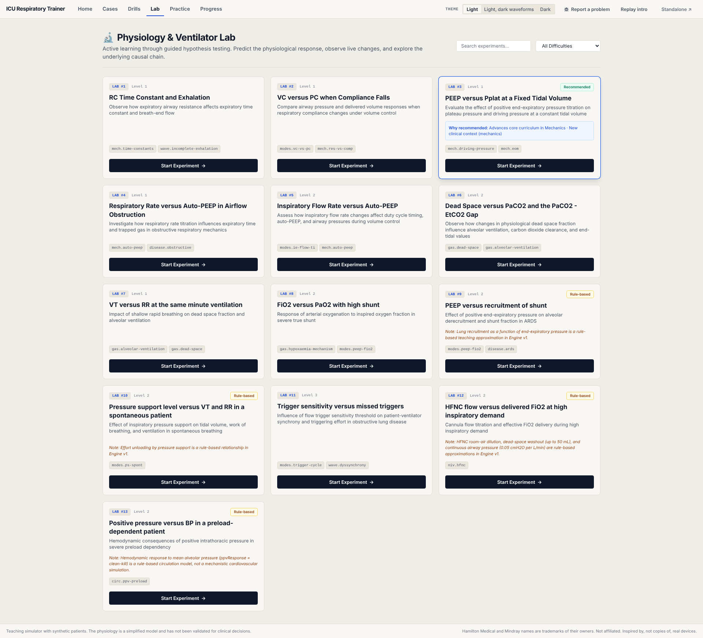

# Driving Pressure

**An active-learning ICU ventilation trainer. Ten to fifteen minutes a day of deliberate practice on simulated ventilated patients.**

> [!WARNING]
> **Work in progress.** This is a personal project under active development, not a finished product.
> Expect rough edges in the layout, cases that still need tuning, and features behind flags.
> The physiology is a simplified teaching model that has **not been clinically validated**.
> It is **not a medical device** and must never be used for decisions about real patients.

Built by **Zakariyya Gardee**, a South African medical doctor with a passion for clinical reasoning and for building medical education tools that promote active learning.
It is based on the open-source [Open Vent Sim](https://github.com/fedebarra/open-vent-sim) by Federico Lorenzo Barra (MIT licence; see [Credits](#credits)).


---

## The idea

Most of us learn the ventilator by standing next to one on a busy shift. You copy the settings someone else chose and you see a handful of patients. You rarely find out what would have happened if you had chosen differently. ICU ventilators can also feel "boring" until the night they are not.

Driving Pressure tries to fix that with short, repeated, safe practice:

- You take over a **simulated patient** (ARDS, COPD on NIV, pneumonia on high-flow oxygen, severe asthma, DKA, weaning trials, high-pressure alarms and more).
- Before you touch anything, you **predict** what will happen. Then you act, and a deterministic physiology engine shows you the result breath by breath.
- Afterwards, a **guided debrief** walks you back through the decisions that mattered, not a wall of numbers.
- A **learner model** tracks which competencies you have shown, and what is due for review today.

The target is a habit, not a course: about **10 to 15 minutes a day**, at home, building real bedside reasoning over weeks.

## The active-learning philosophy

The app is designed around a few principles from the learning-science literature, applied to the ventilator:

1. **Predict before you see.** Each key step asks you to commit to a number or a direction *before* the answer appears, along with how sure you are. Generating an answer and then being corrected teaches far more than watching the right answer appear. A confident wrong prediction is recorded separately, because miscalibration is a safety problem in the ICU.
2. **Act, then reassess.** Cases run in simulated time. Changes take effect on the next breath, blood gases come back after a delay, and patients get better or worse depending on what you do. The rhythm is *assess, act, reassess*, as at the bedside.
3. **Justify your reasoning.** An optional AI consultant (off by default, still experimental) asks *why* you made a change, and does not just tell you whether it was right. The app decides how much help a case allows. Any AI component only phrases the question and never decides the physiology.
4. **Reflect before you are told.** The debrief asks you to explain in your own words what went wrong *before* it shows the takeaway. Then it shows the moments that mattered on a timeline, against a reference run.
5. **Space it and mix it.** Competencies come back for review on a schedule ("due today"). Disguised variants of each case, such as the same ARDS physiology in a different patient, test whether you can transfer the idea rather than memorise the case.
6. **Mastery before progression.** A four-level pathway (ventilator literacy, then mechanics and gas exchange, then non-invasive support, then ICU decisions) unlocks as you show competence, not just as you click through.
7. **No fake physiology.** Waveforms, numbers and alarms come from the engine, never from a script. Cases can change the patient (compliance, resistance, shunt, effort), but they can never set SpO2 or PaCO2 directly.


## What exists today

| Area | Status |
|---|---|
| Physiology engine | Equation of motion with a two-compartment recruitable lung option, expiratory flow limitation and auto-PEEP, CO2 and O2 kinetics, acid-base, patient effort, and mechanistic dyssynchrony (double triggering, early and late cycling, flow starvation). Details: [`docs/ENGINE.md`](docs/ENGINE.md), [`docs/MODEL_CARD.md`](docs/MODEL_CARD.md) |
| Modes | Volume control, pressure control, SIMV, pressure support/CPAP, APRV, NIV (S/T and CPAP), high-flow nasal oxygen |
| Cases | 11 core cases plus 24 disguised variants, each with prediction points, timed events, a rubric and guideline-referenced teaching points |
| Physiology lab | 13 "change one thing and watch" experiments (compliance, resistance, time constants, auto-PEEP, dead space, shunt, recruitment, HFNC, heart-lung interaction) |
| Drills | Blood-gas interpretation, alarm troubleshooting, waveform recognition |
| Learner model | 38 competencies in 8 domains, event-sourced and confidence-weighted, with spaced review and "due today" |
| Debrief | Guided steps: reflection first, then decisions that mattered, course charts, and certain-but-wrong predictions |
| AI consultant | Experimental, off by default; works offline with a local model or with free-tier API keys |
| Tests | 1,060 automated unit, engine and case tests (Vitest), plus browser end-to-end checks (Playwright), including a rendered "text stays inside its box" check at five screen sizes up to 3440×1440 |

### Known gaps (honest list)

- The layout is still being reworked, especially on very wide and very short screens.
- Some engine behaviours are simplified or rule-based, such as the circulation response to severe hypoxia and recruitment in the single-compartment model. These are flagged as such in the lab and in the model card.
- A few clinical thresholds are teaching rules rather than published cut-offs, and they are marked "unverified" in the code until checked.
- The practice-question bank was written from copyrighted textbooks and course material, so it is **not** included here. The Practice screen is empty in a fresh clone.
- Independent clinical review has not happened yet.

## Screenshots

**Curriculum pathway.** It tells you what to do next and why, and later levels unlock with mastery.


**Guided debrief.** You write your reflection before you see the answer, then review the decisions that mattered against target lines.


**Physiology lab.** Single-variable experiments. The rule-based parts of the model are labelled.



## Running it locally

Needs [Node.js](https://nodejs.org/) 18 or newer.

```bash
npm install
npm run dev -- --port 3100
# then open http://localhost:3100/#/trainer
```

Everything runs in the browser and works offline. Progress is stored locally (IndexedDB) and can be exported or reset from the Progress screen. There are no accounts and no telemetry.

Checks:

```bash
npm run typecheck
npm test               # unit, engine and case tests
npx playwright test    # browser end-to-end tests
npm run case:check     # case schema and trajectory checks
```

On Windows you can also double-click `start-trainer.bat`, which builds once and serves the offline version.

## Project structure

```
src/engine/     physiology (equation of motion, gas exchange, dyssynchrony)
src/cases/      case library, variants and expected trajectories
src/runtime/    case clock, events, scoring
src/learner/    competency model and evidence
src/practice/   spaced review and due-today scheduling
src/screens/    home, cases, debrief, progress
src/lab/        physiology experiments with "why" traces
src/tutor/      optional AI consultant (off by default)
tests/          engine benchmarks, case tests, end-to-end checks
docs/           engine description, model card, case authoring guide
```

More detail is in [`ABOUT.md`](ABOUT.md), and the case authoring guide is [`docs/AUTHORING.md`](docs/AUTHORING.md).

## How it was built

I directed the clinical design, the teaching approach and the review of every clinical rule. Much of the code was written with AI coding assistants under that direction. Each physiology rule and threshold is meant to trace back to a named guideline, trial or textbook, and anything I could not verify is labelled "unverified".

## Credits

- **[Open Vent Sim](https://github.com/fedebarra/open-vent-sim)** by Federico Lorenzo Barra (ARTID, Università del Piemonte Orientale), MIT licence. This project started from Open Vent Sim's ventilator interface and grew from there. Please cite the upstream paper if you use the original simulator: [Barra *et al.*, *Advances in Simulation* 2026](https://doi.org/10.1186/s41077-026-00467-2). See [`NOTICE.md`](NOTICE.md).
- Clinical targets cite published guidance by name, for example ESICM ARDS 2023, ERS high-flow 2022, ERS/ATS NIV 2017, GOLD and GINA, and ATS/ACCP liberation 2017. No copyrighted text is reproduced.
- Hamilton Medical and Mindray are trademarks of their owners. Not affiliated.

## Licence

MIT. See [`LICENSE`](LICENSE). Educational use only. Not for clinical decision-making.
